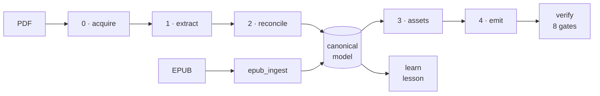
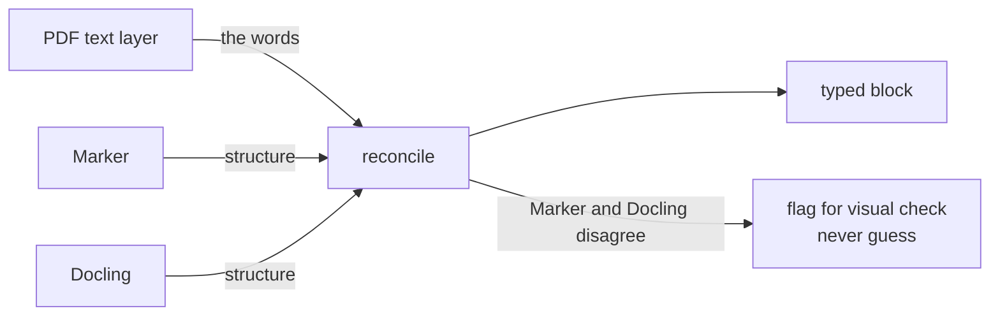
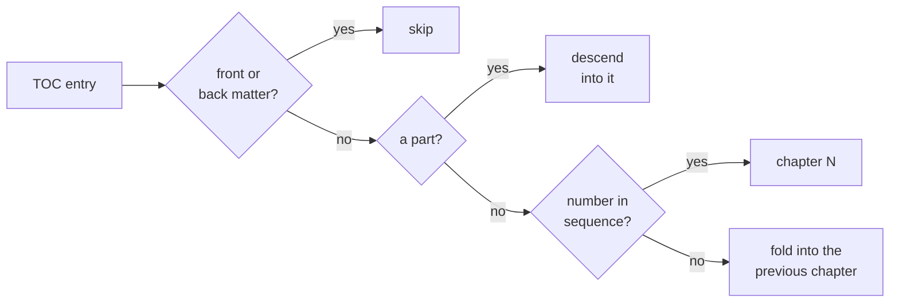
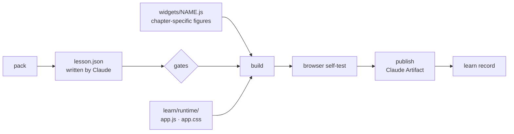

# Architecture

How the pipeline fits together, why, and the failures it was built to catch.
**Read this before changing a stage.**

## At a glance

| Step | Module | Writes |
| --- | --- | --- |
| 0 | `pipeline/stage0_acquire.py` | `work/triage.json`: chapter/part page map |
| 1 | `pipeline/stage1_extract.py` | `work/extract/{marker,docling}/chNN.json` |
| 2 | `pipeline/stage2_reconcile.py` | `work/reconcile/chNN.json`: the canonical model |
| 3 | `pipeline/stage3_assets.py` | figure crops + `work/assets.json` |
| 4 | `pipeline/stage4_emit.py` | `site/docs/**`, `sidebars.ts` |
| verify | `verify/runner.py` | `reports/chNN.json`, `reports/review-queue.md` |
| 0–3 (EPUB) | `pipeline/epub_ingest.py` | `work/triage.json`, `work/reconcile/chNN.json`, `work/assets.json` |
| lesson | `learn/` | `work/learn/chNN/index.html`, `reports/learn-chNN.json` |

- Every step saves to disk: runs resume, outputs can be inspected.
- A chapter is green only when all 8 gates pass (`verify/gates.py`).

## The central decision

- **Words: the text layer.** A model that paraphrases looks like one that
  transcribes until you diff it.
- **Structure: the extractors.** They run independently and check each
  other.
- **Scanned PDF:** no reliable text layer, so model text becomes primary.
  Tests don't cover this path.

## Rules that must not change silently

| Rule | Why |
| --- | --- |
| Chapters are `.md`, not `.mdx` | Book prose is full of bare `<`, `{`, `}`, and each one is an MDX error. `markdown.format: 'detect'` keeps the math plugins. |
| Doc ids carry the chapter number (`id: 02-some-title`) | Docusaurus strips a leading `NN-` from filenames, which breaks every cross-reference. |
| `sidebars.ts`, `docs/index.md`, bibliography are generated | Never hand-edit. Regenerate with `bookery emit`. |
| `onBrokenLinks`, `onBrokenAnchors`, `onBrokenMarkdownLinks` = `throw` | A broken link is a lost cross-reference, not a warning. |
| Preface/introduction is chapter 0 | Same stages and gates for free. Added after the page-offset check, since front matter often has its own (roman) page numbers. |
| `emit` gets **every** chapter | It rebuilds nav, home page and cross-references from the set it's given. The raw stage module on one chapter drops all the others. |

## EPUB ingest

An EPUB skips extraction and reconciliation: `pipeline/epub_ingest.py`
writes the canonical model directly. Blocks carry `source: "epub"`
(`source.format = "epub"` in `triage.json`), and every reader of
`work/reconcile` treats both kinds of book the same.

### The chapter map (the hard part)

A TOC never says which entries are chapters. Each entry goes through this:

- **Front or back matter:** by label (contents, index, notes,
  acknowledgements, "Also by", Vietnamese "mục lục"…). A skipped entry still
  ends the chapter before it.
- **A part:** unnumbered, its children mostly numbered and spread over at
  least 2 spine files. "2 files" is what tells it apart from a chapter with
  numbered sections ("1.1", "1.2" in one file).
- **Unnumbered after the last chapter** (Conclusion, Epilogue): gets the next
  number instead of folding.
- **Sequence check:** "20 Percent Time" isn't chapter 20. A restart (an
  omnibus's second "Chapter 1") ends the sequence, with a note.
- **Fallback:** under 2 accepted numbers, or under 30% of kept entries, means
  sequential numbering. `--renumber` forces it.
- **Chapter 0:** the last opener (Preface, Introduction…) before chapter 1.

**Where a chapter ends:** at the next boundary, skipped entries included, so
back matter never leaks into the last chapter. When converters (calibre
especially) drop the anchor a TOC points at, ingest tries:

1. the same id in the other spine files,
2. a heading with the entry's text,
3. otherwise: drop a chapter that would start where an earlier one starts,
   with a note.

### Reading the XHTML

| Topic | Rule |
| --- | --- |
| Parsing | **XML first.** The HTML parser reads `` as an open tag, so one empty page marker swallows the page. Named entities become numeric; entities and network stay off. HTML parser only as fallback. |
| Mixed containers | Text between block children becomes its own paragraphs, so nothing after the first inline child is lost. |
| Spacing | A space at every block boundary, so "4.1" + "Perfect" doesn't fuse. |
| Headings | From tags and from publisher classes (`CT`, `H1`, `chapterHeadA`…). TOC sub-entries missing from the text get headings inserted. |
| Captions | From classes or a "Figure 3.2" / "Table 2.1" label, bound to the nearest image. |
| Math | MathML → TeX via `alttext` or a TeX annotation. An image with TeX alt text stays `$…$`. An image-only equation is flagged, never given fake `latex`. |
| One file per section (Vellum) | A heading the TOC names takes the TOC's depth. Later headings in that file nest under it, so a chapter doesn't show dozens of top-level sections. |
| Note refs | `noteref`, `doc-noteref`, or a `` holding just an in-book link are dropped ("lines1" → "lines"). Other superscripts (r2) stay. |
| Ornaments | An image used 3+ times, or a thin horizontal stroke, isn't a figure unless captioned. |
| Pages | `epub:type="pagebreak"` sets each block's `page`. `printed_page = pdf_page`, offset 0. No markers → `page: null`. Nothing invents pages. |

## Lessons

**Claude writes data, not a page.**

- A lesson is JSON. Each slide has one main part: a figure, a widget, stats,
  a quote or columns.
- One shared runtime renders every lesson, so present mode, study mode,
  themes, keys and self-test are tested once. The effort goes into teaching,
  not CSS.
- **Figures are the exception.** The best picture is usually specific to the
  idea, so figures are `custom` widgets in `lessons/chNN/widgets/NAME.js`.
  `"static": true` marks one as a figure, not a "your turn" task. Built-in
  charts and tables only where they really fit best.

**Source of truth: `learn/source.py`**, a read-only view of the canonical
model:

- **Blocks:** the only text a lesson may quote or take numbers from.
- **Sections:** numbered "3.1" headings, else the second-shallowest
  unnumbered heading level as `s1`, `s2`…
- **Exhibits:** `fig 3.1` / `tbl 3.1`, or a block id when unlabelled.

**Gates: the site's promise, inverted.** A site must lose nothing. A lesson
drops most of the chapter on purpose and must **make up nothing**.

| Gate | Rule |
| --- | --- |
| `numbers` | Every number a reader sees is in the chapter (0.45 ↔ 45%). A quiz distractor's text is exempt, its `why` is not. |
| `quotes` | Verbatim after normalisation. `...` splits a quote into pieces, each verbatim. |
| `coverage` | A section is taught (a slide cites its block or shows its exhibit) or listed in `skipped` with a reason the page shows. |
| `density` | Word budgets per field, minimum visual slides and book exhibits, at least one recall check. **No interaction quota:** quotas filled early lessons with checks that taught nothing. |
| Transcribed numbers | Numbers read off a book image can't be checked against text. The widget names the images in `transcribed`, `numbers` lists the values for review, and the page shows the images. |
| `runtime` | Headless Chrome loads `preview.html#selftest`: every slide, both modes, every recall check answered. Catches script errors, overflow of the 1600×900 stage, broken images, silent checks, phone-width scroll. No browser → BLOCKED, never PASS. |

- **Outside knowledge** only in a slide's `beyond` field ("Beyond the
  book"), so the book's claims and Claude's never mix.
- **One file for the Artifact sandbox:** figures as WebP data URIs (≤ 1400px
  wide), passages and runtime inlined. Network: Google Fonts, plus KaTeX
  from cdnjs when there's math. `index.html` has no document skeleton (the
  Artifact adds it); `preview.html` adds one for local viewing.
- **Lessons live with the book's data**, never here, because they quote it.
  `lessons/manifest.json` keeps each chapter's Artifact URL, so a rebuild
  republishes to the same link.

## Known extraction pitfalls

Every row was a real defect found on a real book.

> [!WARNING]
> Several passed the coverage and numeric gates because **both sides of the
> comparison were wrong the same way**. A gate that agrees with a wrong
> reference still passes. This is the failure to fear most.

**Figures and captions**

| Pitfall | Do this |
| --- | --- |
| Captions span lines, only line 1 has `Figure N.N:` | Take caption extent from the extractors' caption boxes |
| A figure box swallows its caption: the text drops from page *and* reference, and no gate sees it | Clip figure boxes above the caption. Leave sub-captions inside multi-panel drawings. |
| `[12]` in alt text ends the image syntax early: the figure renders as text | Check figures reach the built HTML as ``, not just disk |
| `(a)`: figure sub-caption or list sub-part? | Decide by font size, not the marker text |

**Text**

| Pitfall | Do this |
| --- | --- |
| Small caps extract in the wrong case | Detect by font metadata, wrap in a span, never re-case |
| Ligatures (`fi`, `ff`) break search | Expand them on output |
| A ligature's trailing space has no character: `payoffmatrix`. The reference is wrong too, so every gate agrees. | Rebuild lines from glyph positions with a gap threshold, and read the page |
| Hyphen kept or dropped differently per page | One attested-forms set for the whole document |
| `.48` and `501st` aren't seen as numbers, on either side | Tokenize bare decimals and ordinals |
| Four-space indent becomes a code block | Use a span class (nested links keep working) |

**Layout and structure**

| Pitfall | Do this |
| --- | --- |
| Running heads vary per page | Detect by position slot, not text recurrence |
| Footnotes found by size alone also match figure labels | Require small font **and** page-bottom position |
| Multi-line heading: only line 1 emitted, the rest becomes prose | Accumulate like captions, parse the label from the joined text |
| Tables drawn with vector rules: neither extractor sees them | Recover from glyph geometry. A single-cell table only with a caption right below. |
| A table emitted as Markdown still trips the assets gate | Track labels emitted as text or tables |
| A 2-D grid has no single reading order: false diffs | Check cell content and row/column placement separately |

**Comparisons and gates**

| Pitfall | Do this |
| --- | --- |
| Per-page cross-extractor number check: false alarms at page breaks | Compare whole chapters, one way only: "extractor saw a number we lack" |
| Extractors emit one region per page fragment: inflated counts | Count items, not provenance regions |
| "Ran and found zero" read as "didn't run" | Block only on missing output, never on an empty list |

## Verification philosophy

- **A gate that never failed is untested.** If it passes because the content
  lacks the feature, say so.
- **Deterministic beats eyeball.** A per-page token-sequence diff catches
  reordering a multiset check misses. Spend eyes on figures, not text.
- **Verdicts are records:** who reviewed, what was checked. Never record one
  for something not inspected.
- **Fix the gate too.** A defect found by eye means the harness has a hole.
