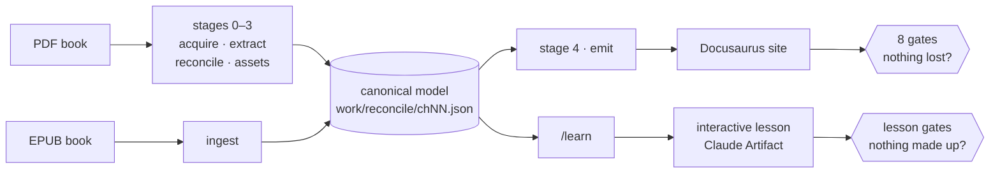
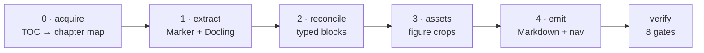
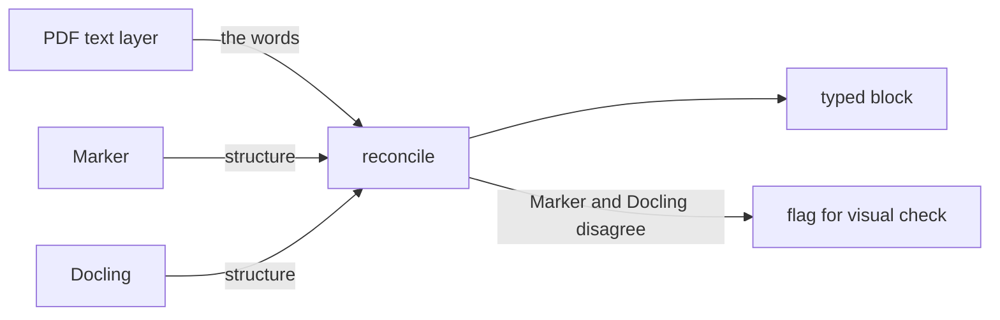
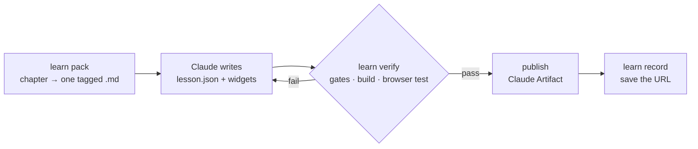
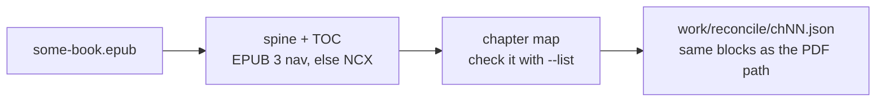

# Bookery

**PDF book → a checked Docusaurus site. Any chapter (PDF or EPUB) → an
interactive lesson.**

[](./LICENSE)
[](./pyproject.toml)
[](https://docs.astral.sh/uv/)



- **Site:** every chapter must pass 8 automated checks before it counts as
  done.
- **Lesson:** a chapter condensed into a figure-rich page. Every number and
  quote on it must exist in the book.
- **No say-so:** nothing is marked done because an LLM or a human said so.

## Quick start

```bash
git clone https://github.com/bug-breeder/bookery.git && cd bookery
uv sync --extra dev

uv run bookery build --pdf path/to/your-book.pdf --all   # every stage, every chapter
uv run bookery readme                                    # starter README.md for this book
uv run bookery view                                      # install JS deps + open the site
```

- The first `uv sync` downloads **several GB** (Marker and Docling pull in
  `torch`).
- **One extractor only?** Use `--extra marker-only` or `--extra docling-only`,
  plus `--only marker` / `--only docling` on `extract` and `build`.
- `build` just chains the stages, so each stage module still runs on its own:
  `uv run python -m pipeline.stage1_extract --chapter 1 --only docling`.

## How it works



Each stage saves its output to disk, so you can resume a run or re-run any
stage on its own.

**The core idea:** words come from the PDF, structure comes from the models.



- A model that paraphrases looks just like one that transcribes, until you
  diff. So model text never overrides the text layer.
- When the two extractors **disagree**, the block is flagged, not guessed.

| # | Gate | Catches |
| --- | --- | --- |
| 1 | `text_coverage` | Body text dropped |
| 2 | `numeric_fidelity` | A number missing, extra or changed |
| 3 | `structural_counts` | Figure/table/section/equation counts ≠ the PDF's |
| 4 | `assets` | A figure on disk that never reaches the HTML as `` |
| 5 | `math` | An equation that fails KaTeX strict mode |
| 6 | `xrefs` | "See Figure 3.2" pointing at nothing |
| 7 | `build` | Site build errors or warnings |
| 8 | `visual` | Everything else, checked page by page against rendered proofs |

## Interactive lessons



A lesson keeps the findings, why they happen, and one or two examples that
stick. Readers **do** things with what they just learned: predict a number,
sort cases, play with a formula.

| Study mode | Present mode |
| --- | --- |
| Scroll at your own pace | 16:9 slide deck |
| The book's passage is one click from every slide | Builds and speaker notes |

In Claude Code the whole loop is one skill:

```
/learn some-book 2           # or: "make chapter 2 into an interactive lesson"
```

Or by hand:

```bash
uv run bookery learn pack   --chapter 2   # the chapter as one Markdown file to write from
uv run bookery learn verify --chapter 2   # gates + build + headless-Chrome self-test
uv run bookery learn shot   --chapter 2 --present --slide offers   # screenshot a slide
uv run bookery learn record --chapter 2 --url https://claude.ai/artifact/...
```

A site must lose nothing. A lesson drops most of the chapter on purpose, so
its gates check the opposite: **nothing made up**.

| Gate | Catches |
| --- | --- |
| `schema` | A malformed slide, or a reference to a figure/block that doesn't exist |
| `grounding` | A content slide that doesn't cite the blocks it condenses |
| `numbers` | A number not in the chapter (0.45 may appear as 45%) |
| `quotes` | A quote that isn't verbatim (`...` may join verbatim pieces) |
| `coverage` | A section neither taught nor skipped with a reason shown to the reader |
| `density` | Walls of text: word budgets per slide, too few figures, no recall check |
| `runtime` | Script errors, overflow, broken images, silent checks, phone scroll |
| `size` | A page too big for an Artifact |

- **Claude's own knowledge** goes only in a slide's `beyond` field, shown as
  "Beyond the book".
- **Full vocabulary** (slide parts, widgets, figure notes):
  [`.claude/skills/learn/authoring.md`](.claude/skills/learn/authoring.md).
- **Lessons quote the book**, so they live with the book's data, never in this
  repo (`lessons/` is git-ignored). Share one only where sharing excerpts is
  fine.

## EPUB books



An EPUB is already structured text, so it **skips stages 0–3**:

```bash
BOOKERY_ROOT=~/books/some-book uv run bookery ingest --epub some-book.epub --list   # check the chapter map
BOOKERY_ROOT=~/books/some-book uv run bookery ingest --epub some-book.epub
```

- **Always run `--list` first.** If the book's numbering is odd, `--renumber`
  numbers the chapters 1..N.
- **Chapter numbers** keep the book's form: "Chapter 3", "3. Sorting",
  "Three", "III".
- **Chapter 0** is a lone Introduction or Preface before chapter 1.
- **Skipped:** contents, index, notes, acknowledgements and similar front and
  back matter. Parts are opened up and their chapters kept.
- **Kept:** headings, paragraphs, lists, tables, footnotes, math as `$…$`,
  figures with their captions and "Figure 3.2" labels.
- **Pages** come from the book's print page markers. No markers means no
  page numbers.

## CLI reference

```
bookery acquire   --pdf FILE
bookery ingest    --epub FILE [--list] [--renumber] [--force]   # instead of stages 0-3
bookery extract   [--chapter N ... | --all] [--pdf FILE] [--force] [--only marker|docling]
bookery reconcile [--chapter N ... | --all] [--pdf FILE]
bookery assets    [--chapter N ... | --all] [--pdf FILE]
bookery emit      [--chapter N ... | --all] [--pdf FILE] [--skip-bibliography]
bookery verify    [--chapter N ... | --all] [--build]
bookery status                                   # regenerate PROGRESS.md
bookery readme    [--force]                      # starter README.md for this book
bookery view      [--build] [--reinstall] [--port N]   # the one command to look at it
bookery build     [--chapter N ... | --all] [--pdf FILE] [--force] [--only ...]
                  [--skip-bibliography] [--skip-verify] [--site-build]

bookery learn pack   [--chapter N ... | --all]
bookery learn build  [--chapter N ... | --all]
bookery learn verify [--chapter N ... | --all] [--no-browser]
bookery learn shot   --chapter N [--slide ID] [--present] [--dark] [--phone]
bookery learn record --chapter N --url URL
```

> [!IMPORTANT]
> `emit` rebuilds the sidebar, home page and cross-references from exactly
> the chapters you pass. Give it **every** chapter (`--all`), not just the new
> one, or the others drop out of the site.

- `--chapter` is repeatable. `--all` means every chapter `acquire` found.
- `view` picks npm, yarn or pnpm from `site/`'s lockfile and installs on first
  run. `--build` serves a production build instead of the dev server.
- `uv run bookery <command> --help` lists every flag.

## Project layout

```
pipeline/           stages 0-4
  cli.py            the `bookery` command
  config.py         shared paths/constants; the only place stage paths live
  epub_ingest.py    `bookery ingest`: an EPUB straight into the canonical model
verify/             the eight-gate harness + independent reference-text builder
learn/              `bookery learn`: pack, lesson gates, build, browser self-test
  runtime/          the lesson page's JS/CSS, inlined into every built lesson
.claude/skills/learn/  the `/learn` skill and its authoring reference
site/               Docusaurus v3 scaffold, pre-wired for this pipeline's output
  docs/             generated by `emit`, not committed
  static/img/       generated by `assets`, not committed
tests/              pytest suite (pure functions, no PDF needed)
scripts/            one-off shell helpers (fetching a source PDF, etc.)
work/               per-run intermediate files (git-ignored)
reports/            per-chapter gate reports + review queue (git-ignored)
ARCHITECTURE.md     design decisions and extraction pitfalls: read this next
```

This repo holds **no book content**. Everything a run produces stays out of
git.

### Book data in another folder

Paths resolve relative to this checkout by default. To keep a book's data
somewhere else, point `BOOKERY_ROOT` at it:

```bash
BOOKERY_ROOT=/path/to/book-store/some-book uv run bookery verify --all
```

That folder needs the same `pdf/`, `work/`, `site/`, `reports/` layout, plus
`epub/` for an EPUB and `lessons/` for lessons.

## Tests

```bash
uv run pytest
```

| File | Covers |
| --- | --- |
| `tests/test_textnorm.py` | Accents, ligatures, quotes, dashes, numbers, hyphenation, "integer soup" |
| `tests/test_epub_ingest.py` | Small EPUBs built on the fly, ingested end to end |
| `tests/test_learn.py` | Lesson gates and build against a synthetic chapter |

No book fixtures ship with the repo. When you find a defect in your book's
output, add a regression test in the same style.

## Known limitations

| Area | Limitation |
| --- | --- |
| Marker | Fast mode, no LLM pass. Equation-heavy pages are its weakest case. |
| Docling | Runs on CPU: its float64 tensors don't work on Apple Silicon's MPS. |
| Scanned PDFs | The model-text-first path isn't covered by tests. |
| Lists | A list set apart only by indentation becomes one paragraph. Nothing is lost, but it reads differently. |
| EPUB → site | `emit` and `verify` haven't been tried on an EPUB yet. EPUBs feed lessons only. |
| EPUB chapter map | Built from TOC heuristics. Odd books can map wrongly: check `--list`, use `--renumber`. |
| EPUB figures | SVG figures aren't exported, only raster images. |
| Lesson runtime gate | Needs Chrome, Chromium or Edge. Without one it reports BLOCKED, never PASS. |

## License

MIT, see [LICENSE](./LICENSE). This repo contains no book content, only the
pipeline, the lesson runtime and the verification tooling.
